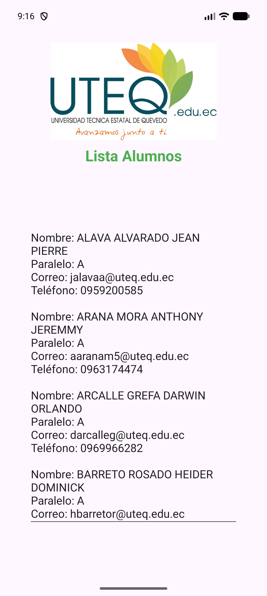

# AppSupabase2026 📱

Aplicación Android desarrollada en **Kotlin** que muestra el **listado de alumnos** almacenados en una base de datos **Supabase (PostgreSQL)**.

El listado es de **solo lectura**: se presenta dentro de un `ScrollView` con un `TextView`, por lo que el usuario puede leer y seleccionar el texto, pero **no puede modificar** los datos.

---

## 📸 Captura de pantalla



> Pantalla principal: logo institucional, título **Lista Alumnos** y el listado completo obtenido en tiempo real desde Supabase.

---

## ✨ Características

- 🔗 Conexión directa a **Supabase** mediante el SDK oficial de Kotlin (`supabase-kt`).
- 📋 Consulta a la tabla **`alumnos`** ordenada alfabéticamente por `nombres`.
- 👀 Visualización **solo lectura** (sin edición ni escritura en la base de datos).
- 📜 Lista desplazable (`ScrollView`) con todos los registros.
- 🛡️ Manejo de errores centralizado con mensajes claros para el usuario.
- 🎨 Interfaz simple con `ConstraintLayout`, logo UTEQ y tema Material.

---

## 🧱 Tecnologías utilizadas

| Componente | Versión |
|---|---|
| Lenguaje | Kotlin |
| Android SDK (compile / target) | 37 |
| SDK mínimo | 37 |
| Jetpack | Core KTX, AppCompat, Activity KTX, ConstraintLayout, Lifecycle |
| Material Components | `com.google.android.material` |
| Supabase Kotlin SDK | `supabase-kt` **3.6.0** (BOM) + `postgrest-kt` |
| Cliente HTTP | Ktor **OkHttp 3.4.3** |
| Serialización | `kotlinx.serialization` (plugin Kotlin 2.3.21) |
| Build | Gradle Kotlin DSL (`.kts`) |

---

## 🗂️ Estructura del proyecto

```
AppSupabase2026/
├── app/
│   ├── build.gradle.kts
│   └── src/main/
│       ├── AndroidManifest.xml
│       ├── java/com/uteq/software/appsupabase2026/
│       │   ├── MainActivity.kt              # Consulta y muestra la lista
│       │   ├── data/
│       │   │   └── SupabaseManager.kt       # Cliente Supabase (URL + KEY)
│       │   ├── models/
│       │   │   └── Alumno.kt                # Modelo @Serializable
│       │   └── utils/
│       │       └── SupabaseErrorHandler.kt  # Manejo de errores
│       └── res/
│           ├── layout/activity_main.xml     # ScrollView + TextView
│           └── drawable/logo.png
├── docs/screenshots/
├── build.gradle.kts
├── settings.gradle.kts
└── README.md
```

---

## 🗄️ Tabla `alumnos`

| Columna | Tipo | Descripción |
|---|---|---|
| `id` | `int8` / PK | Identificador del registro |
| `nombres` | `text` | Nombre completo del alumno |
| `paralelo` | `text` | Paralelo / curso |
| `correo` | `text` | Correo institucional |
| `telefono` | `text` | Teléfono de contacto |

Consulta equivalente en SQL:

```sql
select *
from alumnos
order by nombres asc nulls last;
```

---

## ⚙️ Configuración

Las credenciales del proyecto Supabase están declaradas como constantes en
`app/src/main/java/com/uteq/software/appsupabase2026/data/SupabaseManager.kt`:

```kotlin
object SupabaseManager {

    private const val SUPABASE_URL = "https://<TU-PROYECTO>.supabase.co"
    private const val SUPABASE_KEY = "<TU-ANON-KEY>"

    val client = createSupabaseClient(
        supabaseUrl = SUPABASE_URL,
        supabaseKey = SUPABASE_KEY
    ) {
        install(Postgrest)
    }
}
```

> ⚠️ **Recomendación:** para un proyecto real usa la clave **`anon` / publishable** de Supabase
> y nunca la `service_role` / `secret`, ya que cualquier clave incluida en el APK puede ser extraída.

---

## 🚀 Cómo ejecutar

1. Clona el repositorio:

   ```bash
   git clone https://github.com/CastroKevine2/AppSupabase2026.git
   ```

2. Abre el proyecto en **Android Studio**.
3. Configura la `SUPABASE_URL` y la `SUPABASE_KEY` en `SupabaseManager.kt`.
4. Verifica que exista la tabla `alumnos` con las columnas indicadas.
5. Sincroniza Gradle y ejecuta la app en un emulador o dispositivo (▶ *Run*).

Compilación por consola:

```bash
./gradlew assembleDebug
```

El APK se genera en `app/build/outputs/apk/debug/app-debug.apk`.

---

## 👤 Autor

**Kevin Castro**
📧 kcastroe2@uteq.edu.ec
🏫 Universidad Técnica Estatal de Quevedo (UTEQ)

---

## 📄 Licencia

Proyecto académico desarrollado con fines educativos.
